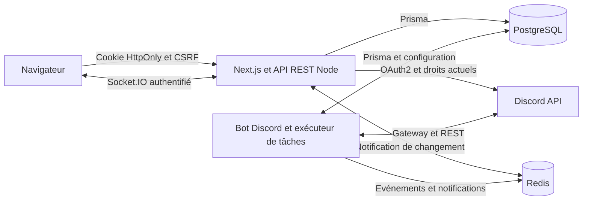

# Architecture et API

Le navigateur n’accède jamais à PostgreSQL, Redis ou au token du bot. Le processus web et le processus bot partagent des services métier et un schéma de données. Il n’existe pas de compte de démonstration ou de contournement local de l’authentification.

## Données

`User` contient les tokens OAuth2 chiffrés AES-256-GCM. `Session` contient uniquement le hash SHA-256 de l’identifiant de session et une valeur CSRF distincte. `Guild` est la racine de chaque serveur. `Config` possède une clé composée serveur/module et une révision optimiste. `Grant`, `Account`, `Level` et `Metric` utilisent des clés composées par serveur. `Audit`, `Case`, `Transaction`, `Entity`, `Ticket` et `Job` référencent toujours leur serveur par clé étrangère.

`Entity` conserve des documents métier validés : panneaux, articles, recrutements, événements, sondages, embeds, commandes, automatisations, staff et suivi RP. Les votes, inscriptions et décisions sont des données réservées au service, conservées lors des modifications de formulaire. Les identifiants de documents seuls ne permettent jamais un accès : leur serveur est vérifié à chaque lecture, modification ou suppression.

`prisma/migrations/202610120001_initial/migration.sql` contient la migration complète du schéma. `GlobalSetting` est accessible au propriétaire global uniquement ; ce droit ne permet pas d’ouvrir les données privées d’un serveur dont il n’est pas administrateur ou délégataire.

## Authentification et permissions

Le flux OAuth2 utilise `identify guilds`, un state à usage unique stocké dans Redis, une cookie liée à ce state et une durée de cinq minutes. Les codes sont échangés uniquement par le serveur. Les sessions durent sept jours et sont stockées dans PostgreSQL. Les tokens renouvelés restent chiffrés.

Chaque requête authentifiée est limitée via Redis. Les écritures exigent l’origine exacte de `APP_URL` et un token CSRF. Les cookies sont HttpOnly/SameSite=Lax, avec Secure en production. Les corps sont limités à 64 Ko et validés avec Zod ; Prisma utilise des requêtes paramétrées. Les requêtes SQL spécifiques de verrouillage utilisent aussi des paramètres.

Avant chaque requête d’administration, l’API lit les rôles du membre et ceux du serveur dans Discord. Le propriétaire et Administrator obtiennent les permissions du dashboard ; les autres membres doivent disposer d’une délégation explicite ou d’un rôle configuré de modération. Une personne ayant quitté Discord perd l’accès même si une délégation subsiste en base. Le propriétaire global n’obtient aucun contournement de ces règles.

Permissions déléguables : `config`, `moderation`, `tickets`, `members`, `roles`, `levels`, `economy`, `content`, `staff`, `logs`, `security`, `data`. La création/révocation des délégations et l’export/suppression des données exigent également Administrator ou la propriété du serveur. La délégation `security` seule ne permet pas d’attribuer de nouvelles permissions.

Le bot vérifie les permissions et la hiérarchie au moment d’exécuter une tâche. Les permissions de dashboard ne remplacent pas les capacités réelles de Discord. Les rôles gérés par une intégration et les rôles de rang supérieur au bot ne peuvent pas être modifiés. Les interactions publiques de vérification/tickets sont bornées à leur serveur et aux droits de l’utilisateur.

## Temps réel et tâches

Les sauvegardes sont transactionnelles avec leur audit. Redis publie ensuite un événement Socket.IO ; la base reste la source de vérité. Le client rafraîchit aussi toutes les trente secondes. Les modifications locales non sauvegardées ne sont pas écrasées par le rafraîchissement. Le bot lit la configuration courante à chaque événement, sans redémarrage.

Les actions externes sont stockées dans `Job` : `queued → running → done/failed`. Le worker traite une tâche à la fois et utilise des verrous PostgreSQL. Une tâche n’est créée que si le heartbeat du bot est récent. Les tâches programmées attendent leur `runAt`. Il n’y a pas de relance automatique d’une sanction ou publication incertaine : une panne entre l’appel Discord et son enregistrement peut nécessiter une vérification humaine. Les tâches interrompues au démarrage sont marquées en échec avec une explication. Ce système ne garantit pas un « exactement une fois » sur une API externe.

Redis fournit les limites de requêtes, cooldowns, compteurs Automod/Antiraid, state OAuth2, quotas IA et notifications. Le Socket.IO authentifie la session, autorise la souscription par serveur et revérifie les droits toutes les trente secondes. Une panne Redis désactive les fonctions qui le nécessitent ; l’API ne les simule pas. Si Redis est absent au démarrage du web, redémarrez le web après restauration pour reconnecter l’abonnement.

Les transferts, gains d’XP, inscriptions et votes utilisent des verrous transactionnels pour protéger les invariants métier sous concurrence. Le tirage utilise `crypto.randomInt` et les modifications concurrentes sont refusées.

## Endpoints principaux

Toutes les écritures sauf le callback OAuth2 demandent une session, une origine autorisée et `X-CSRF-Token`. `g` désigne l’identifiant Discord du serveur.

| Route | Méthodes | Fonction |
|---|---|---|
| `/api/health` | GET | Disponibilité des services, sans secret. |
| `/api/auth/login`, `/api/auth/callback` | GET | Connexion Discord. |
| `/api/me`, `/api/auth/logout` | GET / POST | Profil courant, CSRF, déconnexion. |
| `/api/guilds` | GET | Serveurs administrables ou délégués, invitation. |
| `/api/guilds/g/overview` | GET | Mesures réelles et audit récent. |
| `/api/guilds/g/config/module` | GET, PUT | Configuration et contrôle de révision. |
| `/api/guilds/g/records/module[/id]` | GET, POST, PUT, DELETE | Documents métier validés. |
| `/api/guilds/g/publish/id` | POST | Publication de panneau/embed ou synchronisation des commandes. |
| `/api/guilds/g/moderation` | GET, POST | Historique et tâches de sanctions. |
| `/api/guilds/g/members`, `/roles` | GET, POST | Recherche, création et gestion de rôles. |
| `/api/guilds/g/tickets`, `/transcript/id` | GET, POST / GET | Gestion et téléchargement sécurisé. |
| `/api/guilds/g/levels`, `/economy` | GET, POST | Classements et ajustements. |
| `/api/guilds/g/applications`, `/decision/id` | GET / POST | Candidatures et décisions. |
| `/api/guilds/g/community`, `/participate/id` | GET / POST | Parcours des membres, appartenance Discord requise. |
| `/api/guilds/g/my-economy` | GET, POST | Solde et opérations du membre courant. |
| `/api/guilds/g/shifts[/id]` | GET, POST | Services staff et durée. |
| `/api/guilds/g/verify` | POST | Publication du bouton de règlement. |
| `/api/guilds/g/ai` | POST | Question au fournisseur configuré et quota. |
| `/api/guilds/g/fivem-status` | GET | Lecture sûre d’un endpoint public JSON. |
| `/api/guilds/g/logs`, `/jobs` | GET | Audit et suivi des tâches. |
| `/api/guilds/g/security[/userId]` | GET, PUT, DELETE | Délégations. |
| `/api/guilds/g/data` | GET, DELETE | Export et suppression, confirmation `SUPPRIMER`. |
| `/api/global` | GET, PUT | État global et maintenance, propriétaire uniquement. |

## Vie privée et limites

Le contenu des messages n’est pas conservé par défaut. Les transcriptions échappent le HTML et sont téléchargées avec CSP sandbox. La conservation paramétrable nettoie périodiquement audits, mesures, historiques de tâches/transactions et contenu des tickets clos. La suppression manuelle concerne les données du bot, sans supprimer les messages et salons sur Discord.

La base de données et ses sauvegardes doivent être chiffrées au niveau du disque/stockage en production. Seuls les tokens OAuth2 disposent d’un chiffrement applicatif dans cette version. La CSP laisse les scripts inline requis par Next.js ; une politique à nonce complète reste à implémenter. `unsafe-eval` est limité au mode de développement. Les images distantes des embeds ne sont pas récupérées par le serveur.

L’endpoint FiveM utilise HTTPS public sur le port 443, une résolution IPv4 vérifiée et épinglée pour empêcher le rebinding DNS, bloque les IP internes, les redirections et les réponses excessives. L’API FiveM privée sécurisée avec ressource de jeu n’est pas implémentée. Les automatisations sont une liste d’actions autorisées ; aucun JavaScript fourni par un administrateur n’est exécuté.
